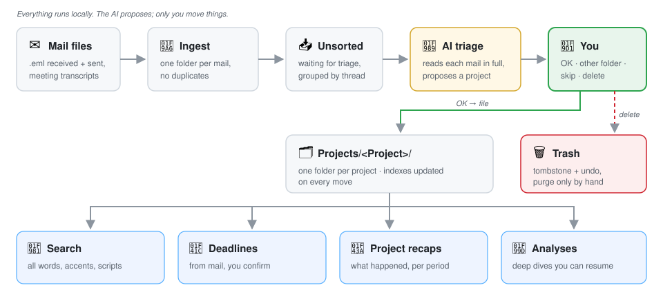

# Menagerie

**A blueprint any AI coding agent can turn into your personal email chief-of-staff: local, human-approved, no cloud.**

Menagerie is not an app you install. It is a set of plain-English documents (architecture, rules, protocols and acceptance tests) that you hand to an AI coding agent such as Claude Code, Codex or Cursor. The agent interviews you about your setup, then builds a version that fits it: your mail client, your operating system, your language, your projects.

It comes from a system that has been in daily use since mid-2026 on more than 7,000 work emails, run by one person with an AI agent. Its rules were learned the hard way: lost mails, duplicate folders, deadlines that slipped. This repository keeps the method and leaves the personal parts out.



## What you get

Your inbox becomes a set of project folders you can actually search, and an AI does the reading for you without ever acting on its own.

- **Every email becomes a folder**: the body and attachment text as Markdown, the original attachments next to it. Plain files that you own, readable by any tool.
- **The AI triages, you decide.** It reads each mail in full and proposes where it belongs, with a short recap. Nothing moves until you say `OK`.
- **Conversations stay together.** Replies of the same thread are presented and filed as one unit.
- **Nothing is ever lost.** "Delete" means "move to the trash", with undo. Duplicates are blocked by an index.
- **It all stays local.** No cloud service sits between you and your mail. The AI only sees what you hand to it.

Optional modules add a deadline planner, a weekly per-project recap, meeting transcripts and an analyses register. Each one is a separate sheet, so you only build what you need.

## Meet the menagerie

Each module has an animal persona. The names are there to make a multi-part system easy to talk about ("ask the Librarian", "let the Owl sort it"):

| Agent | Role | Module |
|---|---|---|
| 🦉 **Owl, the Sorter** | Proposes a destination for each mail and files it once you approve | [Triage](protocols/TRIAGE_PROTOCOL.md) (core) |
| 🦦 **Otter, the Postmaster** | Turns raw `.eml` files into mail folders; blocks duplicates | [Ingest](modules/01_ingest.md) (core) |
| 🦁 **Lion, the Librarian** | Full-text search across the archive, project briefs | [Search](modules/04_search.md) (core) |
| 🐜 **Ant, the Planner** | Deadlines and weekly plans, proposed from mail and confirmed by you | [Deadlines](modules/06_deadlines.md) (optional) |
| 🐺 **Wolf, the Chronicler** | A narrative recap of what happened in a project over a period | [Weekly recap](modules/07_weekly_recap.md) (optional) |
| 🐻 **Bear, the Interpreter** | Meeting transcripts into the same triage flow | [Meetings](modules/08_meetings.md) (optional) |
| 🦝 **Raccoon, the Archivist** | Keeps a register of your in-depth analyses | [Analyses](modules/09_analyses.md) (optional) |

## What a triage looks like

You select some mails and ask your agent to triage them. It reads every file in full and answers in a fixed format:

```text
3 mails = 2 conversations (1 thread with 2+ mails, 1 single mail).

Thread 1 of 2: "Quote for pump replacement", 2 mails, 2026-03-02 → 2026-03-04

## Thread recap
- People: Dana Reyes (Acme Pumps), you
- What it is about: Acme quotes 4 replacement pumps; you asked for a
  delivery date; they confirm week 12.
- Purpose / evaluation: supplier waiting for your purchase order. Valid offer.
- Timeline:
  1. 2026-03-02 09:14, Dana Reyes: quote attached (4 pumps, net 30)
  2. 2026-03-04 16:40, Dana Reyes: delivery confirmed for week 12
- Attachments: quote_AC-2291.pdf (1)
- Proposed deadline: send purchase order, 2026-03-10

## Proposed destination
- Option A (existing): Projects/Plant_Maintenance (same supplier, same plant)

## My choice
→ Projects/Plant_Maintenance

Confirm with OK / type a different folder / skip / delete / stop.
```

The same format every time, from every AI tool, because it is written down in [the triage protocol](protocols/TRIAGE_PROTOCOL.md).

## How to build your own

1. Clone or download this repository.
2. Open your AI coding agent in an empty folder where your system will live.
3. Give it [BUILD_PROMPT.md](BUILD_PROMPT.md) and point it at this repository.
4. Answer its questions: mail client, operating system, language, how much automation you want.
5. It builds the core, then runs the [acceptance scenarios](acceptance/SCENARIOS.md) against the [sample mails](acceptance/sample_mails/). Don't start using it until every scenario passes.

The core (ingest, indexes, triage, trash, search and a small local panel) is a few days of work for an agent working with you. Add modules later, one at a time.

## The rules that make it safe

These are non-negotiable, and the acceptance tests check them. The full list is in [PRINCIPLES.md](PRINCIPLES.md).

1. **The human approves every move.** The AI proposes; only your `OK` files a mail, creates a project or closes a deadline.
2. **Delete means trash.** Nothing is ever removed for real by the system. Purging the trash is a manual act.
3. **Read in full, decide by content.** Never classify by subject line.
4. **Preview before bulk changes.** Every restructuring command has a `--dry-run`.
5. **The indexes follow every move.** A stale index means duplicates later.
6. **One owner per state file.** Every data file is written by one module only.

## Repository map

| Path | What it is |
|---|---|
| [BLUEPRINT.md](BLUEPRINT.md) | Architecture, folder layout, data formats |
| [PRINCIPLES.md](PRINCIPLES.md) | The non-negotiable rules, and why each exists |
| [BUILD_PROMPT.md](BUILD_PROMPT.md) | The prompt for your AI agent: interview, build order, checks |
| [protocols/](protocols/) | The operating protocols the AI follows at run time |
| [modules/](modules/) | One specification sheet per module |
| [acceptance/](acceptance/) | Test scenarios and invented sample mails |
| [docs/STORY.md](docs/STORY.md) | Why this exists and what was learned building it |
| [CONTRIBUTING.md](CONTRIBUTING.md) | How to propose improvements |

## FAQ

**Which AI does it need?** Any coding agent that can read files, write code and run commands. The run-time protocols are plain Markdown, so the same rules work from Claude Code, Codex, Cursor or Gemini.

**Does my mail go to an AI provider?** Only the mails you ask the agent to read, through the AI tool you already use. The system itself has no cloud component.

**Which mail clients?** The blueprint starts from `.eml` files dropped into a folder, which almost every client can export. Your agent can replace that with IMAP, the Gmail API or Microsoft Graph if you ask it to; the rest of the system does not change.

**Why not just use an email client's rules and labels?** Rules match on sender and subject. Here the AI reads the whole mail, attachments included, and explains its proposal. You keep the decision.

## License

[MIT](LICENSE). Use it, adapt it, build on it.
